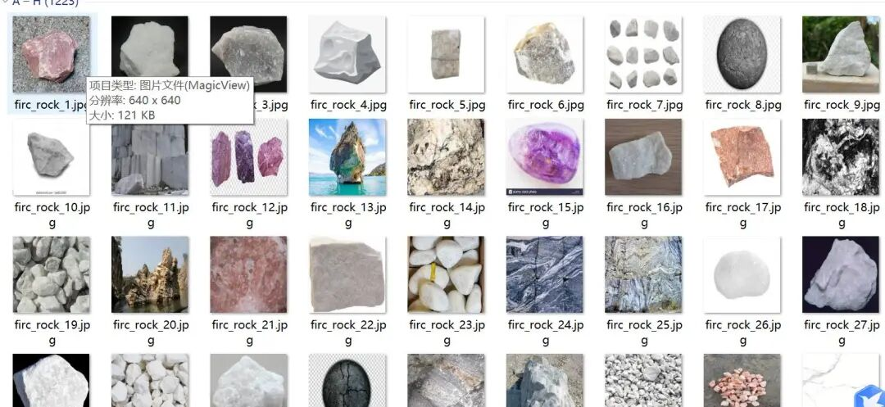
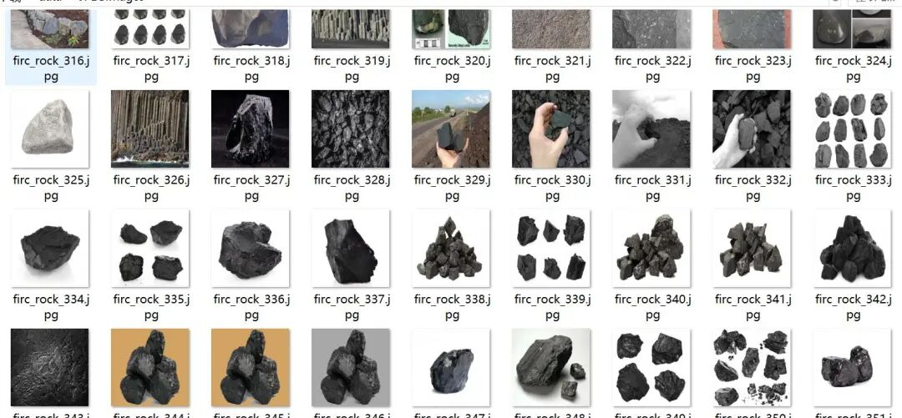
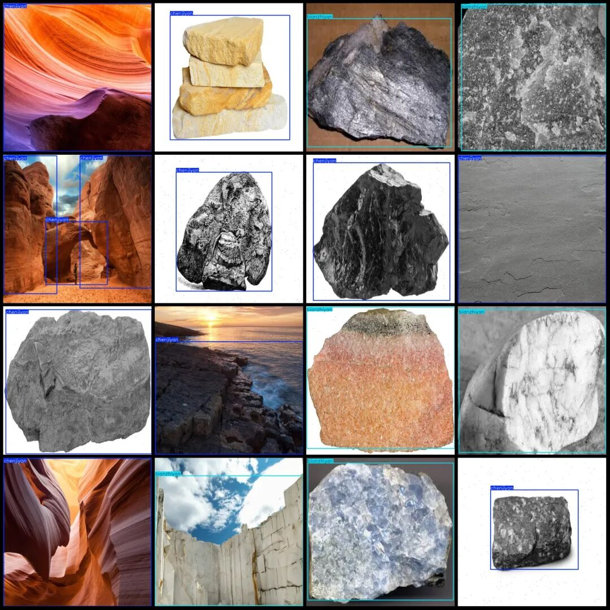
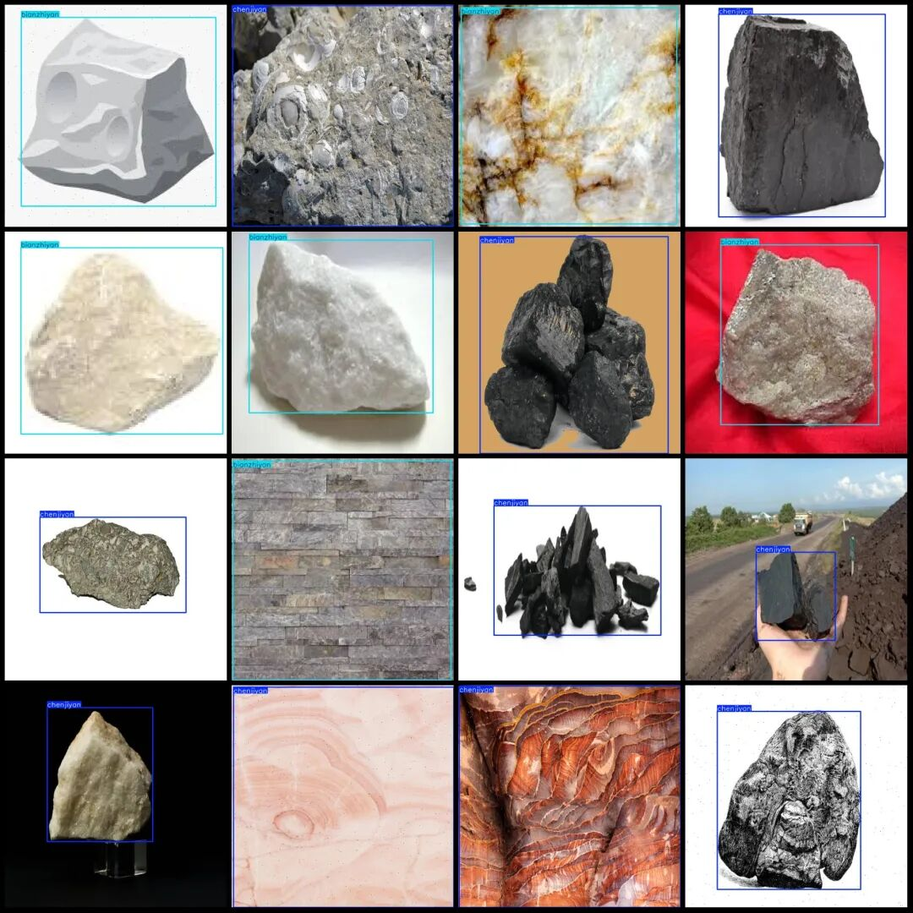

# Rock Classification, Volcanic, Metamorphic, Sedimentary Detection Data Set - VOC+YOLO Format - 1223 Images in 3 Categories

Dataset format: Pascal VOC format + YOLO format (txt file without split path, only containing jpg images and corresponding VOC format xml files and yolo format txt files)

Number of images (number of jpg files): 1223

Number of annotations (number of xml files): 1223

Number of annotations (number of txt files): 1223

Label category count: 3

Label category names (Note that the order of categories in the YOLO format does not correspond to this, but is based on the labels folder's classes.txt): ["bianzhiyan", "chenjiyan", "huochengyan"]

Corresponding Chinese category name: ["Igneous rock", "Metamorphic rock", "Sedimentary rock"]

Number of boxes labeled in each category:

Bianzhiyan Frame Count = 788

chenjiyan frame count = 751

Huochengyan frame count = 233

Total frames: 1772

Number of images per category:

Bianzhiyan's possession of images = 584

Chen Jiyan's total number of photos = 489

Huochengyan's possession of images = 150

Image resolution: 640x640

Using labelImg:

Annotation rules: Draw a rectangle around the category.

Important Notice: The dataset does not have separate training, validation, and test sets; you need to partition them yourself.

Special : This dataset does not guarantee the accuracy of the trained models or weight files.

Image Preview:

Annotation example:

## Payment

Here is a pay link on Stripe ( https://buy.stripe.com/3cs8yP7sY87d0vu9AB ). Please contact me lonlonago@foxmail.com after funding $89, and I will send you a complete data files , thank you!

